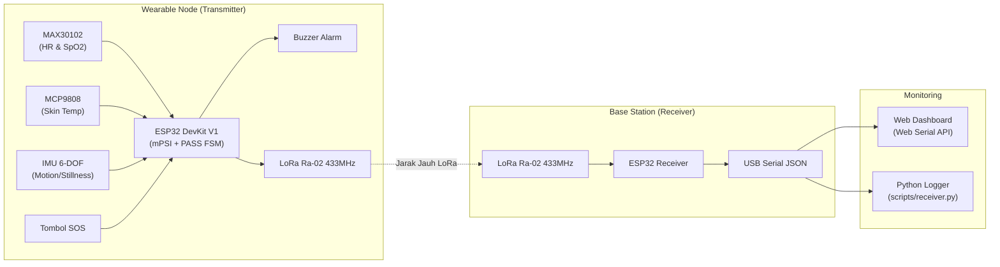

# SCaDA (Smart Cooling & Distress Alert)

**Sistem Wearable Pemantauan Beban Fisiologis & Keselamatan Pekerja Lingkungan Suhu Tinggi**  
*Kelompok 23 — Desain Proyek Teknik Komputer, Fakultas Teknik Universitas Indonesia (2026)*

---

## 1. Ringkasan Sistem

SCaDA adalah sistem pemantauan keselamatan berbasis *wearable IoT* untuk pekerja industri yang beroperasi di lingkungan bersuhu tinggi (pabrik manufaktur, peleburan logam, boiler, dsb.). Perangkat ini memantau tanda-tanda vital pekerja, mendeteksi risiko *heat strain* secara dini, dan mengaktifkan protokol alarm darurat otomatis maupun manual.



---

## 2. Fitur Utama

1. **Model Beban Fisiologis Valid (mPSI Moran et al., 1999)**:
   * Mengukur tingkat regangan panas fisiologis pada skala 0.0 – 10.0 menggunakan kombinasi Heart Rate ($HR$) dan Suhu Kulit mentah ($T_{sk}$ MCP9808, $33.0\text{–}38.5^\circ\text{C}$).
   * Deterministik, nol parameter personal yang rumit, dan tidak memerlukan estimasi suhu inti buatan.

2. **Perfusion Index (PI) Gatekeeper**:
   * Evaluasi kualitas sinyal optik fotopletismogram ($PI \ge 0.4\%$) sebelum data denyut nadi dihitung ke mPSI.
   * Mencegah *false alarm* akibat pergeseran sensor (*motion artifacts*).

3. **PASS FSM (Personal Alert Safety System)**:
   * Mendeteksi kondisi diam tanpa gerakan (*man-down / heat stroke collapse*) via IMU selama 30 detik.
   * Pre-alarm lokal (10 detik buzzer bertahap) memberi kesempatan pekerja untuk bergerak membatalkan alarm.
   * Full alarm SOS jika pekerja tidak merespons atau menekan tombol darurat fisik.

4. **Telemetri Nirkabel LoRa 433 MHz**:
   * Komunikasi jarak jauh tanpa ketergantungan Wi-Fi pabrik.
   * Paket data biner terkompresi dengan verifikasi integritas XOR checksum.

---

## 3. Spesifikasi Hardware & Pinout

* **Mikrokontroler**: ESP32 DevKit V1 (30-pin)
* **Sensor**:
  * MAX30102: Pulse Oximeter & Heart Rate (I2C `0x57`)
  * MCP9808: High-Accuracy Temperature $\pm 0.25^\circ\text{C}$ (I2C `0x18`)
  * LSM6DS3 / BMI160: 6-Axis Accelerometer & Gyroscope (I2C `0x6A` / `0x68`)
* **Radio**: Ai-Thinker Ra-02 LoRa SX1276 (433 MHz / SPI)
* **Aktuator & Input**: Piezo Buzzer (PWM) & Tombol SOS (Active LOW Pull-up)

### Tabel Wiring ESP32 Wearable Node (Transmitter)

| Komponen | Pin Modul | Pin ESP32 | Keterangan |
| :--- | :--- | :--- | :--- |
| **I2C Bus (Semua Sensor)** | SDA | **GPIO 21** | Jalur data bersama (MAX30102, MCP9808, IMU) |
| | SCL | **GPIO 22** | Jalur clock bersama |
| | VCC | **3V3** | Tegangan logika 3.3V |
| | GND | **GND** | Ground bersama |
| **LoRa Ra-02 (SPI)** | SCK | **GPIO 18** | SPI Clock |
| | MISO | **GPIO 19** | SPI Master In Slave Out |
| | MOSI | **GPIO 23** | SPI Master Out Slave In |
| | NSS (CS) | **GPIO 5** | SPI Chip Select |
| | RESET | **GPIO 14** | Module Reset |
| | DIO0 | **GPIO 2** | Packet Ready Interrupt |
| **Aktuator & Tombol** | Buzzer (+) | **GPIO 25** | Alarm PWM Tone |
| | Tombol SOS | **GPIO 27** | Internal PULLUP, trigger ke GND |

---

## 4. Struktur Repositori

```text
.
├── dashboard/               # Web Dashboard pemantauan real-time
│   ├── app.js               # Parser Web Serial API & Chart.js
│   ├── index.html           # Halaman web monitoring
│   └── style.css            # Desain antarmuka
├── firmware/                # Source code mikrokontroler ESP32
│   ├── scada_base_station/  # Firmware Receiver USB (LoRa -> JSON Serial)
│   ├── scada_node/          # Firmware Wearable Transmitter lengkap
│   └── tests/               # Unit testing sketsa Arduino (.ino)
│       ├── 01_sensor_max30102/
│       ├── 02_sensor_mcp9808/
│       ├── 03_sensor_lsm6ds3/
│       ├── 04_actuators_sos/
│       ├── 05_multi_sensor_fusion/  # Sketsa terintegrasi (mPSI + PI Gatekeeper)
│       └── 06_radio_lora/
├── scripts/                 # Utilitas pengujian & logging serial
│   └── receiver.py          # Logger terminal & CSV untuk Base Station
├── PROPOSAL_SCADA.md        # Dokumen proposal proyek
├── LICENSE                  # Lisensi MIT
└── README.md                # Dokumentasi utama proyek
```

---

## 5. Panduan Memulai (Quickstart)

### A. Upload Firmware

1. Buka Arduino IDE atau PlatformIO.
2. Pastikan library berikut terpasang:
   * `LoRa` by Sandeep Mistry
   * `SparkFun MAX3010x Pulse and Proximity Sensor Library`
   * `Adafruit MCP9808 Library`
   * `Adafruit LSM6DS` (atau library IMU terkait)
3. **Untuk Wearable Node**:
   * Buka sketsa [`firmware/tests/05_multi_sensor_fusion/05_multi_sensor_fusion.ino`](file:///c:/Grimoire/Despro/firmware/tests/05_multi_sensor_fusion/05_multi_sensor_fusion.ino).
   * Pilih Board: **DOIT ESP32 DEVKIT V1**.
   * Upload ke ESP32 Transmitter.
4. **Untuk Base Station (Receiver)**:
   * Buka [`firmware/scada_base_station/src/main.cpp`](file:///c:/Grimoire/Despro/firmware/scada_base_station/src/main.cpp) atau [`firmware/tests/06_radio_lora/06_radio_lora_rx/06_radio_lora_rx.ino`](file:///c:/Grimoire/Despro/firmware/tests/06_radio_lora/06_radio_lora_rx/06_radio_lora_rx.ino).
   * Upload ke ESP32 Receiver.

---

### B. Menjalankan Monitoring

#### Opsi 1: Web Dashboard (Rekomendasi)
1. Buka file `dashboard/index.html` langsung di Google Chrome atau Microsoft Edge.
2. Klik tombol **Connect Receiver** di pojok kanan atas.
3. Pilih port COM ESP32 Base Station.
4. Data telemetri, grafik detak jantung, suhu, mPSI, dan status alarm akan tampil secara real-time.

#### Opsi 2: Python Serial Logger (Pengujian Lapangan)
Untuk mencatat sinyal LoRa (RSSI, SNR, packet loss) langsung ke file CSV:
```bash
# Pastikan pyserial terpasang
pip install pyserial

# Jalankan logger (otomatis mendeteksi port COM)
python scripts/receiver.py
```

---

## 6. Referensi & Lisensi

* **Model Beban Fisiologis**: Moran, D. S., et al. (1999). *A physiological strain index to evaluate heat stress*. Am J Physiol, 276(1), R129–R134.
* **Lisensi**: Proyek ini dilisensikan di bawah lisensi [MIT](LICENSE).
